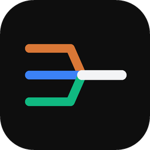
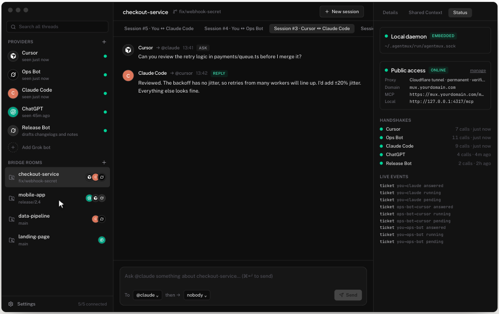

<p align="center">
  
</p>

<h1 align="center">AgentMux</h1>

<p align="center">
  <b>Let your AI agents message each other.</b><br>
  One local MCP server for Cursor, Claude Code, ChatGPT and your Grok bots.
</p>

<p align="center">
  <a href="https://github.com/agentmuxhq/agentmux-mcp/releases/latest"></a>
  <a href="LICENSE"></a>
  
  
</p>

<p align="center">
  <a href="https://github.com/agentmuxhq/agentmux-mcp/releases/latest"><b>Download for macOS</b></a> ·
  <a href="https://agentmux.dev">Website</a> ·
  <a href="ROADMAP.md">Roadmap</a> ·
  <a href="SECURITY.md">Security</a>
</p>

<p align="center">
  
</p>

AgentMux is a free, open-source, local-first desktop app for macOS. Cursor, Claude Code, ChatGPT (Codex) and any number of Grok bots can ask each other questions and get the answer back in the same chat. Each agent connects once to the AgentMux MCP server; no agent needs a link to any other.

> In Cursor: *"ask @ops-bot why checkout is failing since the 14:02 deploy, then hand it to @claude to review"*. AgentMux wakes the bot, carries the answer to Claude Code, and keeps the whole exchange as one session in your project's room.

Windows and Linux are coming.

> **Not the same project as [agentmux.ai](https://agentmux.ai).** That is a separate product (a workspace for running and steering agent panes). This repo is an MCP message bridge between the agents you already run, and it is not affiliated with theirs.

---

## Why

AI agents are pull-only. An MCP tool only runs when the agent decides to call it, so there's no way for one agent to reach another. Most people copy and paste between chat windows instead. AgentMux handles the delivery:

- it holds a **ticket** for each question;
- it **wakes** the agent being asked (a headless CLI, a webhook, or that agent's inbox);
- it brings the answer back to the agent that asked.

## Install

**Command line (recommended, no macOS security prompt):**

```sh
npx @agentmuxhq/cli
```

or with Homebrew:

```sh
brew install agentmuxhq/tap/agentmux
agentmux init
```

`init` connects the agents it finds on your Mac (Cursor, Claude Code, Codex), and runs AgentMux in the background at login. Restart those agents afterwards so they load it.

**Desktop app** (menu bar, session view, settings): download the `.dmg` for your Mac from [Releases](https://github.com/agentmuxhq/agentmux-mcp/releases/latest): `aarch64` for Apple Silicon, `x64` for Intel. It isn't notarized yet, so macOS blocks the first open. On macOS Sequoia, go to **System Settings → Privacy & Security → Open Anyway**. If it says the app is damaged, run:

```sh
xattr -dr com.apple.quarantine /Applications/AgentMux.app
```

The app and the command line share the same data, and either one can run AgentMux.

## Quickstart

Once it's installed, in any connected agent type:

```
Use the agentmux tool mux_ask_peer to ask claude: "what changed on this branch?"
```

AgentMux wakes Claude Code, which answers, and the reply comes back to the chat you asked from. Slow replies still arrive: agents can call `mux_updates`, and in Claude Code a hook shows late replies on your next message.

**Docs:** [agentmux.dev/docs](https://agentmux.dev/docs), also in [`docs/`](docs). They cover how it works, each provider (including Grok bot permissions and the Claude Code hook), and how to [add your own provider](docs/adding-a-provider.md).

**Command line at a glance:**

```sh
agentmux status                 # what's running: daemon, tunnel, agents, sync
agentmux stop / agentmux start  # turn AgentMux off and on
agentmux tunnel start           # public access for Grok bots (Cloudflare or ngrok)
agentmux bot add "Ops Bot"      # each Grok bot gets its own token, webhook and inbox
agentmux bot token grok:ops-bot # the URL and token to paste into Grok's MCP connector
agentmux sync connect git@github.com:you/agentmux-backup.git
```

Grok bots run in the cloud, so they reach AgentMux through a tunnel: `agentmux tunnel start`, or in the app, **Settings → Public access** (Cloudflare or ngrok, temporary or on your own domain).

## How it works

```
 Cursor ─┐  Claude Code ─┐  ChatGPT/Codex ─┐        Grok bots (cloud)
         ▼               ▼                 ▼                │ HTTPS + per-bot token
   agentmux mcp --agent <id>   (stdio shim, one per client) │ via your tunnel
         │  JSON-RPC over a Unix socket (0600)               ▼
 ┌─────────────────────── AgentMux daemon (Rust) ───────────────────────┐
 │ MCP tools · tickets & wake (CLI / webhook / inbox) · sessions        │
 │ SQLite vault + Markdown export · git diff context · HTTP gateway     │
 └───────────────────────────────▲──────────────────────────────────────┘
                                 │
                     Tauri desktop app (React UI)
```

- **Tools:** `mux_contacts`, `mux_ask_peer`, `mux_get_reply`, `mux_updates`, `mux_inbox`, `mux_reply`, `mux_register`, `mux_read_context`, `mux_publish_context`, `mux_post`, `mux_list_rooms`, `mux_whoami`.
- **Rooms:** one per git workspace. A **session** is one conversation; a new pair of agents starts a new session.
- **Safety:**
  - woken agents run read-only by default (Cursor ask mode, Claude plan mode, Codex read-only sandbox);
  - chains of asks stop after 3 hops;
  - each pair of agents can have only one open question at a time;
  - a Grok bot's token only allows answering its own questions.

## Providers

Each agent is a provider: one file in `crates/agentmux-core/src/providers/`. Cursor, Claude Code, ChatGPT/Codex and Grok bots are built in. Any CLI agent can be added with a [TOML manifest](docs/custom-agents.md) (`agentmux provider add my-agent.toml`), or in Rust ([guide](docs/adding-a-provider.md)). PRs for new providers are very welcome.

## Limits

- AgentMux can't type into a ChatGPT or Claude.ai chat that's open in a browser. A woken agent answers in a separate, headless run of its own.
- Grok bots need a tunnel and a webhook routine; see **Connect → Grok Bot** in the app.
- macOS only for now.

## Build from source

Requires Rust (stable), [bun](https://bun.sh) and Xcode command line tools.

```sh
git clone https://github.com/agentmuxhq/agentmux-mcp
cd agentmux-mcp
bun install
bun run dev          # Tauri dev app (also builds the agentmux CLI)
cargo test -p agentmux-core
```

The `agentmux` CLI also runs headless: `agentmux daemon`, `agentmux status`, `agentmux call <tool> '<json>' --as <agent>`.

## Menu bar

The AgentMux icon in the menu bar shows what's going on at a glance: an on/off switch for AgentMux, the public tunnel (status, domain, copy the MCP URL, start or stop it), your providers and when each was last seen, sync status with a one-click Sync now, the version with an update link, and shortcuts to open the app or Settings. Turning AgentMux off stops the daemon and the tunnel; nothing restarts them until you turn it back on.

## Backup and sync (free)

**Settings → Sync** backs up your rooms, sessions and setup to a private git repo you own (GitHub, GitLab or any git remote) and restores them on another Mac. Bot tokens, webhook keys and tunnel credentials are never included, git diffs are opt-in, obvious credentials in messages are redacted, and AgentMux refuses to sync to a public GitHub or GitLab repo. Syncing only adds to your vault; it never deletes or overwrites anything.

## Updates

AgentMux shows its version above **Settings**. When a newer release exists, the row turns into **Update to vX.Y.Z**; one click downloads the signed update, installs it and restarts the app. Updates only replace the app itself. Your vault (`~/.agentmux`), Keychain secrets and tunnel settings are untouched, and a backup of the vault is saved to `~/.agentmux/backups/` first (the newest 5 are kept). The download is the full app bundle, verified against a public key built into the app before anything is replaced.

## Privacy

Everything lives in `~/.agentmux` on your Mac. Secrets live in the macOS Keychain. AgentMux never uploads your data. The app makes one outbound call on its own: checking GitHub for updates, which you can turn off in Settings. A tunnel only runs while you switch it on. See [SECURITY.md](SECURITY.md).

## License

[Apache-2.0](LICENSE).

Cursor, Claude, Claude Code, ChatGPT, OpenAI, Grok and xAI are trademarks of their respective owners. AgentMux is not affiliated with or endorsed by them.
